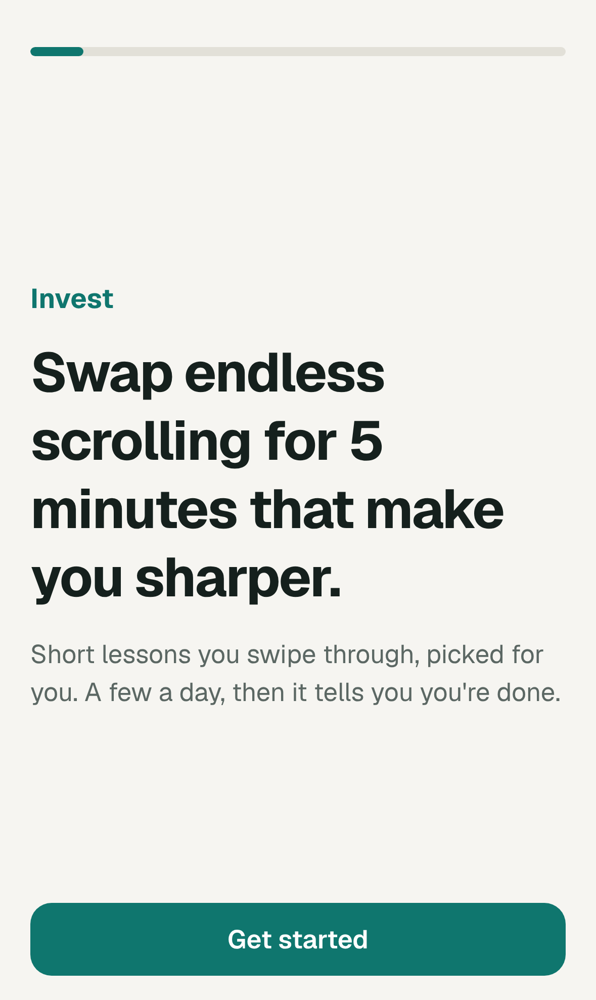
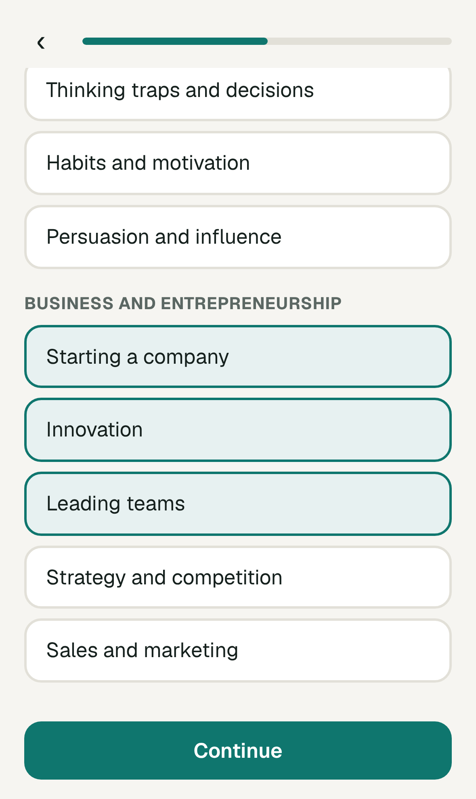
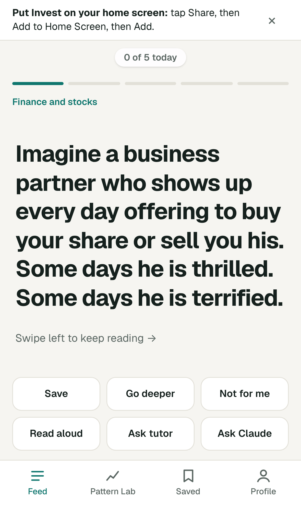
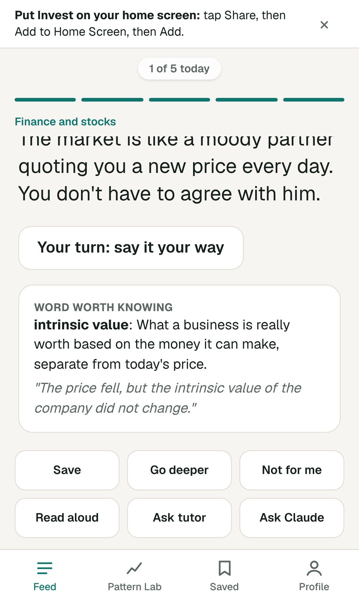
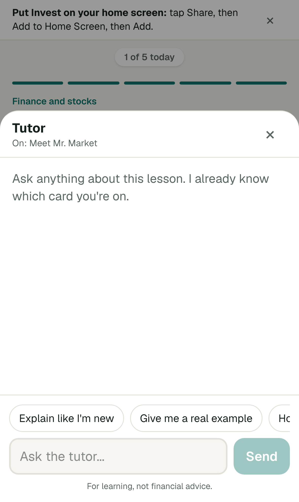
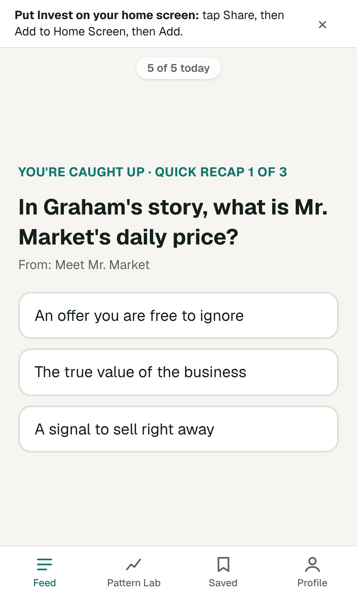
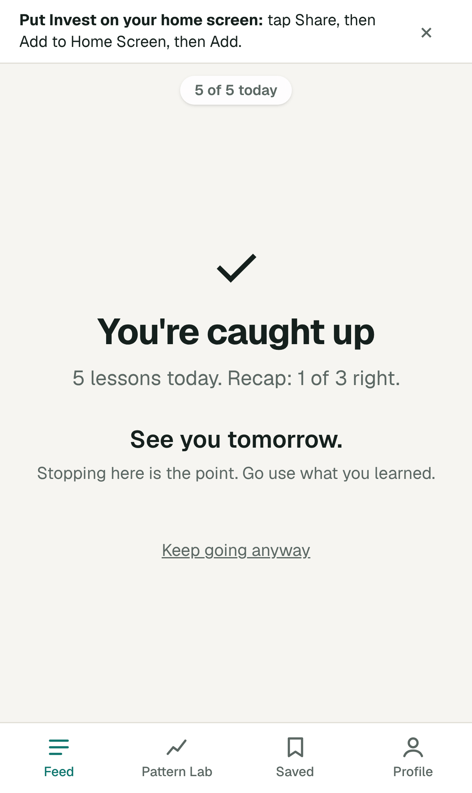
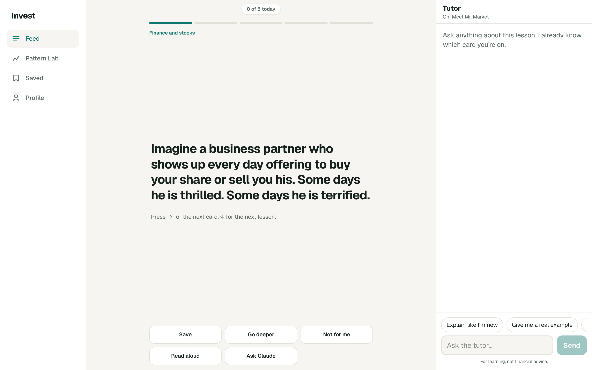
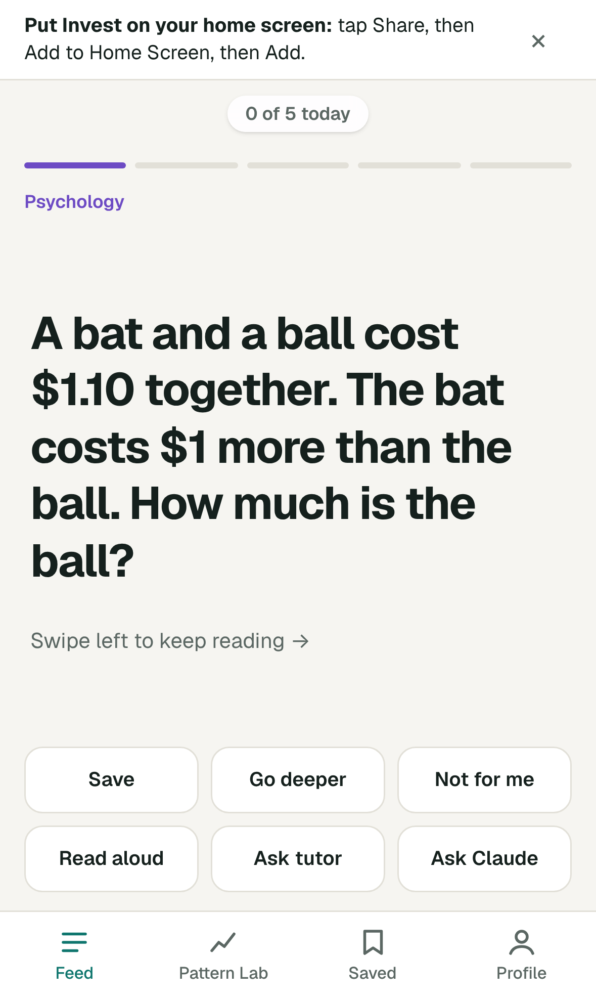

# Test report: new-user runs (after phases 5 and 7)

Date: 2026-11-25. Run with `tests/new-user.mjs` from an empty database and no saved session each time.

**Read this first, these limit what the numbers mean:**

- The spec asks for WebKit with the iPhone 15 profile. WebKit was not available in the build environment, so the phone runs used **Chromium with the iPhone 15 device profile** (same screen size, touch and user agent, different engine). Safari-only behaviour is untested.
- The times are a script tapping as fast as it can. They show the flow is short, not how long a person takes. Nobody has timed a human yet.
- The tutor was not tested against a real model (no AI Gateway access here). Only its "not connected" path ran.
- Pattern Lab is not built, so the phase 8 run and the Pattern Lab questions for Persona A have not happened.

## Results (after fixes)

| | Persona A, phone | Persona A, laptop | Persona B, phone |
|---|---|---|---|
| Taps to first lesson | 23 | 23 | 11 |
| Scripted time to first lesson | 7.5 s | 7.3 s | 6.0 s |
| Screens before the first lesson | 8 (9 with Face ID on a real device) | 8 | 8 |
| First 3 lessons match picks | Yes | Yes | Yes |
| First 3 lessons | Meet Mr. Market / How to spot a trend / Your brain has two speeds | same | Your brain has two speeds / Why losing hurts more than winning / The free Coke trick |
| Wildcard position | none in first 5 | none in first 5 | 5th lesson |
| Daily stop after 5 lessons | Yes | Yes | Yes |
| Recap questions | 3 | 3 | 3 |
| Comes back later same day | Goes straight to "See you tomorrow" | same | same |
| Closing mid-onboarding resumes | Yes | Yes | Yes |
| Layout overflow | None | None | None |
| Console errors | None | None | None |

Persona A's 23 taps: 3 goals, 3 topics, 7 subtopics, 1 level, 1 nudge choice and 8 Continue or Skip taps. The minimum path is 11.

Passkey flow (`tests/passkey.mjs`, Chromium virtual authenticator): wrong setup code refused, registration works, `/setup` refuses afterwards, the setup code is useless to anyone without a session, login works, API returns 401 without a session. All pass.

## Before and after

| | First run | After fixes |
|---|---|---|
| Serious issues | 6 | 0 known |
| Persona B's first 3 lessons match picks | No (a finance lesson was 3rd) | Yes |
| Laptop first lesson readable | No | Yes |
| Taps and time | unchanged | unchanged |

Serious issues found and fixed:

1. **Laptop: the lesson text and buttons were invisible.** The card area had no height. Fixed the layout.
2. **Phone: the "Add to Home Screen" banner covered the top of the card.** It now sits above the feed and pushes it down.
3. **Persona B got a finance lesson third.** With one topic picked, the "no more than 2 in a row" rule was pulling in topics she never chose. Now other topics only appear as the 1-in-5 wildcard, labelled "Something different".
4. **Coming back the same day replayed the recap quiz.** It now shows once a day.
5. **Closing the app mid-onboarding restarted from the welcome screen.** It now resumes.
6. **After registering a passkey, the next screen failed with "Bad request".** Fixed.

## Open problems, worst first

1. **The content will run dry in about three days.** There are 16 lessons, all written from the book shelf. No live feed is connected because none could be checked from the build environment. Until the daily task runs and feeds are verified, the feed falls back to repeats.
2. **The tutor is unproven.** It has never answered a real question. Model choice, answer quality and the buy/sell refusal all need a live test.
3. **The daily nudge question does nothing yet.** The spec says every question must change something. It should be hidden until phase 9, or phase 9 built.
4. **Pattern Lab is an empty tab** that says so. Fine for now, annoying if it stays.
5. **Six buttons under every card.** Instagram has none in the way. Save, Go deeper, Not for me, Read aloud, Ask tutor and Ask Claude is a lot for a first-timer. Worth trying a single "more" button.
6. **"Narrow it down" is a long scroll with three topics** (15 options). It keeps onboarding at 10 screens, but the spec asked for one screen per topic. See the note below.
7. **Persona B's wildcard is a finance story** (the janitor). It is plain-language and labelled, but a skeptic may still read it as the app ignoring her choice.
8. **The install prompt appears twice** on iPhone Safari: once in onboarding, then again as the banner.
9. Words a first-timer might trip on: "passkey" (laptop setup screen), "nudge", "wildcard" is not shown but "Something different" has no explanation.

## Decision to confirm

The spec asks for at most 10 screens and also one subtopic screen per chosen topic. With three topics those conflict (12 screens). This build puts all subtopics on one grouped screen and all levels on one screen, which gives exactly 10.

## Check by hand on a real iPhone

- [ ] Add to Home Screen, and it opens full screen
- [ ] Face ID setup on `/setup`, then unlock from the home screen icon (not just Safari)
- [ ] Lock screen appears after 15 minutes in the background
- [ ] Read aloud works
- [ ] Sideways swipe between cards and vertical swipe between lessons both snap cleanly
- [ ] Nothing hides behind the notch or the home bar
- [ ] Daily nudge arriving (after phase 9)

## Screenshots

| Welcome | Narrow it down | First lesson |
|---|---|---|
|  |  |  |

| Say it to a friend | Tutor | Recap |
|---|---|---|
|  |  |  |

| Caught up | Laptop | Persona B first lesson |
|---|---|---|
|  |  |  |
